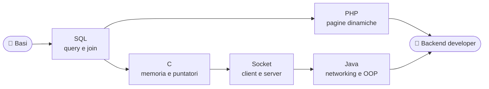

<!-- Banner con onde e stelline animate -->

<!-- Emoji animata che saluta -->

<!-- Testo che si scrive e si cancella in loop -->

  

<!-- Badge del profilo -->

  

<!-- Tecnologie con icone -->

<!-- Linea decorativa sfumata -->

---

## 👋 Chi sono

> *"Un buon database è come una buona base: non si vede, ma regge tutto."*

Mi chiamo **Matteo**, per tutti **Becca**, e vivo a **Polesella (RO)**. Studio programmazione e mi appassiona tutto quello che sta dietro le quinte di un'applicazione: dati, query e comunicazione in rete.

<table align="center">
  <tr>
    <td>🔭 <b>Sto lavorando su</b></td>
    <td>Database e Socket</td>
  </tr>
  <tr>
    <td>🌱 <b>Sto imparando</b></td>
    <td>SQL · PHP · C · Java</td>
  </tr>
  <tr>
    <td>🎯 <b>Obiettivo</b></td>
    <td>Diventare un backend developer</td>
  </tr>
  <tr>
    <td>😄 <b>Soprannome</b></td>
    <td>Becca</td>
  </tr>
</table>

---

## 🛠️ Stack e tecnologie

 

---

## 🗺️ Il mio percorso di apprendimento

## 📊 Statistiche

 

SERPENTE DEI CONTRIBUTI

  <picture>
    <source media="(prefers-color-scheme: dark)" srcset="https://raw.githubusercontent.com/MatteoBeccari05/MatteoBeccari05/output/github-snake-dark.svg"/>
    
  </picture>

---

## 📌 Progetti in evidenza

---

## 📫 Contatti

  

